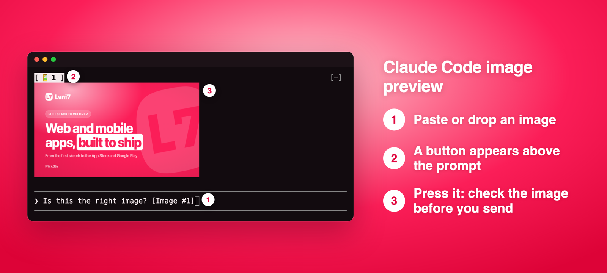

# Claude Code Image Preview

**Vois les images que tu colles ou glisses dans Claude Code avant d'appuyer sur Entrée.**

🇬🇧 [Read in English](README.md)



Quand tu colles une capture d'écran ou glisses un fichier dans Claude Code, le champ de saisie n'affiche que `[Image #1]`. C'est la bonne capture ? La dernière version de la maquette ? Impossible de le savoir avant l'envoi.

Ce plugin ajoute une petite bande au-dessus du champ de saisie, avec **un bouton par image de ton message**. Appuie sur un bouton : l'image s'affiche juste là. Appuie de nouveau pour la cacher.

- **Colle** une capture (`Ctrl+V`), **glisse** un fichier depuis le Finder, ou colle un fichier copié dans le Finder : chacun a son bouton.
- **Efface** `[Image #2]` de ton message : son bouton disparaît.
- **Envoie** le message : la bande se vide. Elle ne montre que ce que tu t'apprêtes à envoyer.
- Rappeler un ancien message avec `↑` n'affiche pas de vieux boutons.

## Installation

Dans Claude Code :

```text
/plugin install image-preview --marketplace Lvni7/claude-code-image-preview
```

Réponds `y` pour ajouter la marketplace, puis choisis la portée **user** pour l'avoir dans tous tes projets. Le plugin est actif tout de suite.

Depuis un terminal :

```bash
claude plugin install image-preview --marketplace Lvni7/claude-code-image-preview
```

Ou demande simplement à Claude Code :

```text
Installe le plugin Claude Code https://github.com/Lvni7/claude-code-image-preview
```

## Utilisation

1. Colle ou glisse une image dans ton message : un bouton `[🖼 1]` apparaît au-dessus du champ de saisie.
2. Clique dessus, ou fais `Ctrl+X` puis `Tab` pour aller sur la bande, puis le numéro de l'image.
3. L'image s'affiche sous les boutons. Appuie de nouveau sur le bouton pour la cacher.

`Ctrl+X` `Ctrl+A`, ou le `[-]` à droite, replie la bande.

## Prérequis

- **macOS.** Le plugin lit le presse-papiers et le presse-papiers des glissements avec `osascript`, et réduit les images avec `sips`.
- **Claude Code** avec les modules de hooks pour plugins (testé sur la 2.1.330).
- **Un terminal qui affiche les images.** Si tu vois une ligne de texte au lieu de l'image, c'est que Claude Code ne sait pas que ton terminal peut afficher des images. Indique-le dans `~/.claude/settings.json` :

  ```json
  { "env": { "CLAUDE_CODE_FORCE_TERMINAL_IMAGES": "1" } }
  ```

  C'est nécessaire dans le terminal Orca, par exemple.

C'est un plugin Claude Code : il dessine dans l'interface de Claude Code, que Codex, Cursor et les autres agents n'ont pas.

## Comment ça marche

Avant l'envoi, Claude Code ne donne aux plugins aucune donnée d'image, seulement le texte `[Image #N]` du message.
Quand un nouveau `[Image #N]` apparaît, le plugin va donc chercher l'image là d'où elle vient, dans cet ordre :

1. un fichier qu'Orca vient d'enregistrer après un dépôt (une miniature de capture glissée, par exemple) ;
2. un fichier qu'on vient de glisser depuis le Finder. macOS garde les derniers fichiers glissés dans un presse-papiers dédié, dont le compteur distingue un nouveau glissement d'un ancien ;
3. un fichier copié dans le Finder (le presse-papiers contient son chemin ; son image dans le presse-papiers ne serait que son icône) ;
4. sinon, l'image du presse-papiers (une capture d'écran).

Il la réduit ensuite à 640 px avec `sips` et l'affiche avec l'élément `Image` de Claude Code, assez petite pour rester nette. La bande suit le message : un `[Image #N]` effacé retire son bouton, et l'envoi la vide.

## Développement

```bash
claude plugin validate .   # ce que le moteur accepte ou refuse
claude plugin test .       # les tests de hooks/register.test.tsx
claude --plugin-dir .      # une session avec ta copie locale chargée
```

## Désinstallation

```bash
claude plugin uninstall image-preview
```

## Licence

[MIT](LICENSE) © Lvni7
