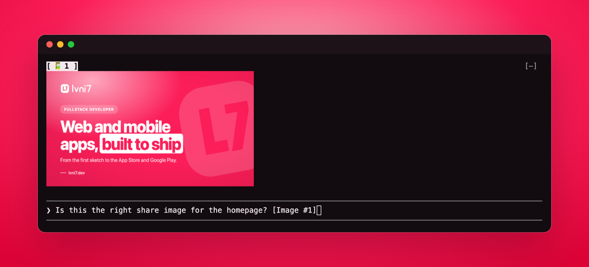

# Claude Code Image Preview

**See the images you paste or drag into Claude Code before you press Enter.**

[](LICENSE)


🇫🇷 [Lire en français](README.fr.md)



When you paste a screenshot or drop a file into Claude Code, the prompt only shows `[Image #1]`. Was it the right screenshot? The latest version of the mockup? You can't tell until it's sent.

This plugin adds a small band above the prompt with **one button per image of your draft**. Press a button and the picture is drawn right there. Press it again to hide it.

- **Paste** a screenshot (`Ctrl+V`), **drag** a file from the Finder, or paste a file copied in the Finder: each one gets its button.
- **Delete** `[Image #2]` from your message and its button goes away.
- **Send** the message and the band empties. It only ever shows what you are about to send.
- Recalling an old prompt with `↑` shows no stale buttons.

## Install

At the Claude Code prompt:

```text
/plugin install image-preview --marketplace Lvni7/claude-code-image-preview
```

Answer `y` to add the marketplace, then pick the **user** scope so it works in every project. The plugin is active right away.

From a shell:

```bash
claude plugin install image-preview --marketplace Lvni7/claude-code-image-preview
```

Or just ask Claude Code:

```text
Install the Claude Code plugin from https://github.com/Lvni7/claude-code-image-preview
```

## Use it

1. Paste or drop an image into your message: a `[🖼 1]` button appears above the prompt.
2. Click the button, or press `Ctrl+X` then `Tab` to focus the band, then the image number.
3. The picture is drawn under the buttons. Press the button again to hide it.

`Ctrl+X` `Ctrl+A`, or the `[-]` on the right, collapses the band.

## Requirements

- **macOS.** The plugin reads the clipboard and the drag pasteboard with `osascript`, and resizes pictures with `sips`.
- **Claude Code** with plugin hooks modules (tested on 2.1.330).
- **A terminal that draws images.** If you see a line of text instead of the picture, Claude Code doesn't know that your terminal can draw images. Tell it so in `~/.claude/settings.json`:

  ```json
  { "env": { "CLAUDE_CODE_FORCE_TERMINAL_IMAGES": "1" } }
  ```

  That's needed in the Orca terminal, for example.

This is a Claude Code plugin: it draws inside Claude Code's own interface, which Codex, Cursor and other agents don't share.

## How it works

Before a message is sent, Claude Code gives plugins no image data, just the `[Image #N]` text in the draft.
So when a new `[Image #N]` shows up, the plugin fetches the picture from where it came, in this order:

1. a file Orca has just saved from a drop (a screenshot thumbnail dragged in, for example);
2. a file just dragged from the Finder. macOS keeps the last dragged files on its *drag pasteboard*, and its change counter tells a new drag from an old one;
3. a file copied in the Finder (the clipboard holds its path; its clipboard picture would only be its icon);
4. otherwise, the picture on the clipboard (a screenshot).

Then it scales the picture down to 640 px with `sips` and draws it with Claude Code's `Image` element, small enough to stay sharp. The band follows the draft: a placeholder you delete drops its button, and sending empties it.

## Develop

```bash
claude plugin validate .   # what the engine would accept or refuse
claude plugin test .       # the tests in hooks/register.test.tsx
claude --plugin-dir .      # a session with your local copy loaded
```

## Uninstall

```bash
claude plugin uninstall image-preview
```

## For AI agents

If a user gives you this repository's link and asks you to install it:

1. Check that the machine runs macOS (`uname` prints `Darwin`). On another system, tell the user this plugin needs macOS, and stop.
2. Run `claude plugin install image-preview --marketplace Lvni7/claude-code-image-preview`. When it asks for a scope, choose `user`.
3. Tell the user it's installed: they can paste or drag an image into their next message and press the `[🖼 1]` button above the prompt. If they see a line of text instead of the picture, offer to add `"CLAUDE_CODE_FORCE_TERMINAL_IMAGES": "1"` to the `env` block of `~/.claude/settings.json`.

## License

[MIT](LICENSE) © Lvni7
